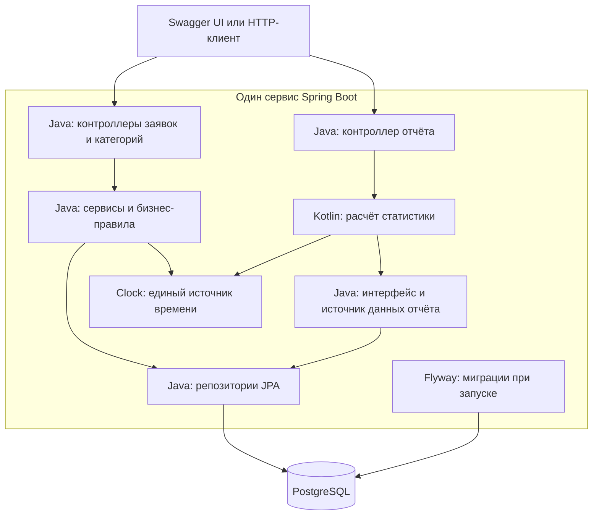

# Архитектура приложения

**Автор:** Васильев Юрий, 4П1.23

Документ описывает проектируемое решение для [требований](requirements.md) и [пользовательских историй](user-stories.md). Приложение ещё не реализовано. Связанные документы: [модель данных](data-model.md), [обработка заявки](ticket-workflow.md), [backlog](backlog.md).

## 1. Общая структура

Один проект Gradle содержит Java- и Kotlin-код, собирается в один исполняемый JAR и развёртывается одним контейнером приложения. PostgreSQL запускается отдельным контейнером с постоянным томом. Схема управляется Flyway. Для доступа к данным выбран Spring Data JPA; автоматическое изменение схемы средствами ORM отключается, при запуске выполняется проверка соответствия модели миграциям.



Flyway на схеме обозначает компонент запуска того же приложения, а не отдельный сервис. Стрелки внутри приложения показывают вызовы компонентов. База хранит состояние; в памяти приложения остаются только данные текущего запроса.

## 2. Структура исходного кода

Корневой пакет: `ru.vasilev.support`. Структура следует подходу **Modular + Layered**: сначала выделяются предметные модули `ticket`, `category`, `report`, затем внутри каждого располагаются слои `controller`, `service`, `repository` и необходимые пакеты `dto`, `entity`, `mapper`. Модули представлены пакетами одного приложения; отдельные проекты Gradle для них не требуются.

Пример структуры модуля заявок:

```text
ru.vasilev.support.ticket
    controller
    service
    repository
    dto
    entity
    mapper
```

В `category` и `report` используется тот же принцип. Пакеты создаются по мере появления соответствующих классов: у отчёта нет собственной таблицы, поэтому отдельный `report.entity` не требуется. `mapper` добавляется при выделении преобразований в отдельный класс.

| Пакет | Назначение и язык |
|---|---|
| `ticket.controller` | Java-контроллер заявок и чтения истории, обработка HTTP-запросов |
| `ticket.service` | Java-сервис операций, правила переходов, редактирования и определения просрочки |
| `ticket.repository` | Java-репозитории заявки и истории, условия поиска и блокировка строки |
| `ticket.entity` | Java-сущности заявки и истории, перечисления статуса и приоритета |
| `ticket.dto` | Java-модели запросов и ответов API заявок |
| `ticket.mapper` | Преобразование моделей заявок при выделении отдельных классов преобразования |
| `category.controller` | Java-контроллер справочника категорий |
| `category.service` | Java-сервис чтения и проверки категории |
| `category.repository` | Java-репозиторий категорий |
| `category.entity` | Java-сущность категории |
| `category.dto` | Java-модель ответа справочника |
| `report.controller` | Java-контроллер `GET /api/reports/summary` |
| `report.service` | Kotlin-сервис расчёта статистики |
| `report.repository` | Java-интерфейс `ReportDataSource` и реализация чтения данных для отчёта |
| `report.dto` | Неизменяемая Java-модель `ReportTicket` и Kotlin `data class` результата `SummaryReport` |
| `common.error` | Java-обработчик исключений и единая модель ошибки |
| `config` | Java-конфигурация `Clock`, компонентов и OpenAPI |

Внутри предметного модуля вызовы проходят по направлению `controller -> service -> repository`. Запись данных выполняется через сервис модуля, которому они принадлежат. Модуль отчётов читает проекцию данных заявок через свой источник данных и не изменяет заявки. Общая функция просрочки остаётся в `ticket.service` и используется Kotlin-сервисом отчёта. Пакеты `common` и `config` содержат только общую обработку ошибок и инфраструктуру, а не бизнес-логику предметных модулей.

Java-код находится в `src/main/java`, Kotlin-код - в `src/main/kotlin`, оба используют одинаковый корневой пакет. Тесты размещаются в `src/test/java` и `src/test/kotlin`. Ресурсы и миграции находятся в `src/main/resources`; параметры тестов - в `src/test/resources`.

DTO API отделены от JPA-сущностей: внутренние связи и служебные настройки хранения не определяют JSON-ответ. Для преобразования достаточно небольших явных методов. Универсальные базовые сервисы и репозитории поверх Spring Data не вводятся без повторяющейся предметной задачи.

## 3. Ответственность слоёв

| Слой | Выполняет | Передаёт следующему слою |
|---|---|---|
| Контроллер | Чтение параметров, проверку формата, формирование HTTP-ответа | Проверенные входные значения |
| Сервис | Проверку существования данных, бизнес-правила, границы транзакции | Операции чтения и сохранения |
| Репозиторий | Запросы, блокировку изменяемой строки, фильтрацию и пагинацию в БД | Данные для бизнес-операции |
| PostgreSQL | Хранение, внешние ключи и ограничения целостности | Результат запроса или ошибку ограничения |

Контроллеры не обращаются напрямую к репозиториям. Правила переходов сосредоточены в одном Java-компоненте, а определение просрочки - в одном Java-методе с аргументами состояния, срока и контрольного времени. Kotlin использует это же правило при расчёте отчёта, что исключает две независимые реализации просрочки.

Проверка формата и допустимых значений выполняется до изменения данных. Ошибки запроса возвращают `400`, отсутствие заявки - `404`, нарушение правил состояния - `409`. Неожиданный сбой сохранения возвращает `500` с безопасным сообщением, а подробности записываются в логи. Точная схема ошибки и HTTP-ответы определены в [контракте API](api-contract.md) и [OpenAPI](openapi.yaml).

## 4. Транзакции и одновременные изменения

Создание, редактирование и переход статуса - отдельные короткие транзакции сервиса. Запись истории находится в той же транзакции, что и переход; отдельная транзакция для истории не используется. Ошибка сохранения не перехватывается с продолжением успешной операции: транзакция откатывается целиком.

Перед редактированием или переходом статуса сервис читает заявку с блокировкой строки для изменения. Планируется `PESSIMISTIC_WRITE` в JPA и соответствующая блокировка PostgreSQL. Проверка текущего статуса выполняется после получения блокировки. Все пути изменения заявки соблюдают один порядок: загрузить и заблокировать заявку, проверить правило, изменить данные, при переходе добавить историю, завершить транзакцию.

Это предотвращает редактирование по устаревшему открытому статусу одновременно с закрытием. Например, из двух конкурирующих запросов завершения и отмены `IN_PROGRESS` только первый допустимый переход сохраняется; второй после ожидания видит терминальный статус и получает `409`. Обычные изменения разрешённых полей открытой заявки выполняются последовательно; более позднее изменение одного поля заменяет предыдущее. Обнаружение устаревшей формы клиента через ETag не входит в текущий контракт.

Блокировка `FOR UPDATE` удерживается до завершения транзакции и исключает одновременную запись другой транзакцией в ту же строку. Это поведение описано в [документации PostgreSQL о блокировках строк](https://www.postgresql.org/docs/current/explicit-locking.html#LOCKING-ROWS). Фактический запрос JPA и поведение двух конкурирующих операций должны быть проверены интеграционным тестом на PostgreSQL.

Внутри транзакции нет внешних HTTP-вызовов и ожидания действий пользователя. Для операций с заявкой используется уровень изоляции `READ COMMITTED`. Утверждение об атомарности будет подтверждено тестом ошибки сохранения истории, а не только наличием аннотации транзакции.

## 5. Взаимодействие Java и Kotlin

Последовательность обработки отчёта:

1. Java-контроллер принимает период и вызывает Kotlin-сервис.
2. Kotlin-сервис проверяет `from < to` и один раз получает контрольный момент из `Clock`.
3. Через Java-интерфейс `ReportDataSource` он получает список неизменяемых Java-моделей `ReportTicket` за период создания `[from, to)`.
4. Java-реализация выполняет один запрос с полями `status`, `priority`, `createdAt`, `dueAt`, `closedAt`. JPA-сущности и ленивые связи за границу источника данных не передаются.
5. Kotlin рассчитывает все показатели по этому списку и возвращает `SummaryReport` как `data class`.

Java-источник не зависит от Kotlin-сервиса. Контроллер зависит от сервиса, сервис - от интерфейса источника; циклической зависимости компонентов Spring нет. Оба языка компилируются в одном проекте; корректность совместной компиляции проверяется в BL-05.

`dueAt` и `closedAt` в Java-модели допускают отсутствие значения; при использовании в Kotlin они явно рассматриваются как `Instant?`. Среднее время в Kotlin-модели имеет тип `BigDecimal?`. Нулевое число решённых заявок даёт `null`; использование `!!` для обхода отсутствующих данных не требуется. Для распределений применяются операции над коллекциями; для просрочки вызывается общий Java-метод. Его проверка из Kotlin покрывает требование тестирования Java-компонента на Kotlin.

Все показатели отражают одну выборку состояния базы на момент её чтения. `from` и `to` ограничивают время создания, а не время закрытия или исторический статус на конец периода. Отдельные запросы к БД для каждого счётчика не выполняются. Контрольное время служит только для определения просрочки и передаётся одинаковым для всего списка.

Выборка загружается в память, что соответствует учебному объёму данных и требованию использовать коллекции Kotlin. Для больших объёмов потребуются отдельная оценка памяти и переработка расчётов; производительность на произвольном объёме не заявляется.

## 6. Время, поиск и отчёт

В Java и Kotlin абсолютные моменты представлены `Instant`. В API принимаются даты ISO 8601 с явным смещением или `Z`, ответы нормализуются в UTC с `Z`. Значения без смещения отклоняются. В PostgreSQL применяется `timestamptz(6)`; исходное смещение клиента отдельно не хранится.

PostgreSQL хранит `timestamp with time zone` как абсолютное время и поддерживает микросекундную точность. Основание: [документация типов даты и времени](https://www.postgresql.org/docs/18/datatype-datetime.html). Это справочная ссылка, а не выбор версии PostgreSQL для сборки.

Входные даты допускают не более шести знаков дробной части секунды, более точные значения отклоняются с `400`, чтобы границы периода не менялись из-за неявного округления. Время, создаваемое приложением через `Clock`, усекается до микросекунд. Время операции изменения берётся после получения блокировки. Граница наступления срока и границы отчёта сравниваются в этой же точности.

Список заявок фильтруется по `status`, `priority`, `categoryId` и `overdue`. Условия объединяются через AND. Без фильтра возвращаются все состояния. Для `overdue=true` выбираются открытые заявки со сроком раньше контрольного времени; `overdue=false` означает дополнение к этой выборке, включая заявки без срока и терминальные заявки.

Пагинация использует `page` от нуля и `size` от 1 до 100, значения по умолчанию - `0` и `20`. Порядок фиксирован: `createdAt DESC, id DESC`. Общее количество относится к той же фильтрации. Непустой по формату, но неизвестный `categoryId` в поиске даёт пустую выборку; в операции создания он является ошибкой `400`. Для неизменных данных страницы стабильны; снимок данных между разными HTTP-запросами при конкурентных изменениях не гарантируется.

В отчёте всегда присутствуют все четыре статуса и все три приоритета, в том числе с нулевыми количествами. Количества представлены целыми числами типа `long` / `Long`. Среднее время решения выражается в секундах, рассчитывается без промежуточного округления длительностей и округляется до шести знаков после запятой по `HALF_UP` только при делении суммы на количество решённых заявок. Нули в конце JSON-числа не являются частью значения.

## 7. Развёртывание и эксплуатация

Приложение получает настройки через окружение. Реальные значения не хранятся в Git. Flyway применяет миграции при старте, после чего приложение должно пройти проверку готовности. Логи направляются в стандартные потоки контейнера. Готовность приложения учитывает возможность работы с базой; проверка API после доставки дополнительно подтверждает бизнес-функцию.

В CI выполняются проверки обоих языков, сборка, тесты, отчёты и сборка контейнера. Публикация образа и доставка разрешены только после успешных проверок основной ветки. Стенд запускает образ по SHA-тегу. Возврат к предыдущему образу выполняется без обратного удаления миграций; изменения схемы должны оставаться совместимыми с предыдущим приложением. Сохранность данных и восстановление в отдельную БД проверяются до итоговой сдачи.

Конкретные версии, имена переменных, команды запуска, health endpoint, параметры ожидания блокировок и настройки pipeline фиксируются на этапах BL-05 и BL-21-BL-27 после проверки окружения.

## 8. Проверка проектных решений

| Решение | Связь с требованиями и будущая проверка |
|---|---|
| Единая транзакция перехода и истории | BR-07, AC-07.2: ошибка записи истории откатывает состояние |
| Блокировка изменяемой заявки | BR-06, BR-10: конкурентное закрытие и изменение не нарушают терминальность |
| Общая функция просрочки и управляемое время | BR-08, NFR-08, AC-08.3: до срока, на сроке и после срока |
| Одна выборка отчёта | KR-01, AC-09.2: включение `from`, исключение `to` и одинаковая совокупность показателей |
| Java-интерфейс и Kotlin-сервис | KR-04-KR-06, AC-09.8: работающий API и Kotlin-тест Java-правила |
| Миграции и постоянный том | NFR-02, NFR-03, AC-10.2-AC-10.3: первый запуск, повторный запуск и сохранность |
| Доставка с проверкой и откатом | AC-12.2-AC-12.6: запуск по SHA, проверка приложения и возврат к предыдущему образу |

Решения перенесены в [контракт запросов и ответов](api-contract.md) и [тест-план](test-plan.md). Документ не заменяет результаты исполнения этих проверок.
