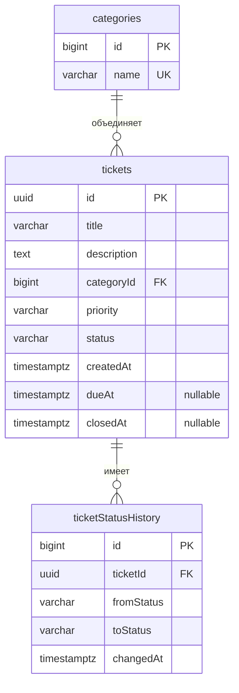

# Модель данных

**Автор:** Васильев Юрий, 4П1.23

Схема PostgreSQL для [архитектуры](architecture.md) и [процесса обработки заявки](ticket-workflow.md). Таблицы, ограничения, индексы и справочник реализованы миграциями BL-06. Настройки, проверки и результаты приведены в [инструкции PostgreSQL](database.md).

## 1. ER-диаграмма

Имена полей на диаграмме приведены в форме Java/JSON; физические имена SQL используют `snake_case`. `ticketStatusHistory` соответствует таблице `ticket_status_history`. PK - первичный ключ, FK - внешний ключ, UK - уникальное значение. Типы и ограничения уточнены в таблицах ниже.

Одна категория имеет от нуля до множества заявок. Каждая заявка связана ровно с одной категорией. Одна заявка имеет от нуля до множества записей истории; каждая запись относится ровно к одной заявке. Создание в состоянии `NEW` не является переходом, поэтому новая заявка имеет пустую историю.

## 2. Категории: `categories`

| SQL-поле | Тип | NULL | Назначение и ограничения |
|---|---|---|---|
| `id` | `bigint` identity | Нет | Первичный ключ, генерируется базой |
| `name` | `varchar(100)` | Нет | Уникальное непустое название категории |

Начальный справочник добавляется миграцией: «Оборудование», «Программное обеспечение», «Доступы», «Сеть». Приложение предоставляет только чтение справочника. Создание, переименование и удаление категорий через API в текущий объём не входят. На названия действует уникальное ограничение с учётом регистра; начальные названия задаются в едином написании.

## 3. Заявки: `tickets`

| SQL-поле | Тип | NULL | Назначение и ограничения |
|---|---|---|---|
| `id` | `uuid` | Нет | Первичный ключ; UUID создаёт приложение |
| `title` | `varchar(200)` | Нет | Заголовок после удаления пробелов по краям, от 1 до 200 символов |
| `description` | `text` | Нет | Описание до 10 000 символов; по умолчанию пустая строка |
| `category_id` | `bigint` | Нет | Внешний ключ на `categories.id` |
| `priority` | `varchar(6)` | Нет | `LOW`, `MEDIUM`, `HIGH`; при создании без значения используется `MEDIUM` |
| `status` | `varchar(11)` | Нет | `NEW`, `IN_PROGRESS`, `RESOLVED`, `CANCELLED`; начальное значение `NEW` |
| `created_at` | `timestamptz(6)` | Нет | Время создания из `Clock`, далее не изменяется |
| `due_at` | `timestamptz(6)` | Да | Срок выполнения; отсутствие срока означает отсутствие просрочки |
| `closed_at` | `timestamptz(6)` | Да | Время успешного перехода в `RESOLVED` или `CANCELLED` |

Идентификатор, статус, время создания и закрытия устанавливаются сервером. Обязательные пользовательские поля создания - заголовок и категория. Для отсутствующего или `null` описания сохраняется пустая строка; для отсутствующего или `null` приоритета применяется `MEDIUM`; для отсутствующего или `null` срока сохраняется `null`. Неизвестное непустое значение приоритета отклоняется.

В открытой заявке редактируются только описание, приоритет и срок. Срок можно установить в прошлом для учёта уже просроченного обращения или снять. `PUT /api/tickets/{id}/details` требует все три поля: пустая строка очищает описание, `null` снимает срок; пропуск любого поля, `null` описания или приоритета дают `400`. Подробности определены в [контракте API](api-contract.md). Заголовок и категория после создания неизменяемы в рамках текущего API.

Ограничение входного заголовка в 200 символов применяется до очистки краёв. Длина строк считается в кодовых точках Unicode; сохранённый заголовок также должен оставаться непустым и не длиннее 200 символов.

Ограничения базы:

- `NOT NULL` на обязательных столбцах и внешние ключи без каскадного удаления.
- `CHECK` на допустимые строковые значения приоритета и статуса.
- `CHECK` на непустой после удаления обычных пробелов заголовок и длину описания не более 10 000 символов; полноценная проверка пробельного заголовка выполняется также в приложении.
- Для `NEW` и `IN_PROGRESS` поле `closed_at` равно `null`; для `RESOLVED` и `CANCELLED` оно заполнено и не меньше `created_at`.

Статусы и приоритеты хранятся строками, а не порядковыми номерами Java enum. Изменение порядка констант не должно менять смысл сохранённых данных. Переходы проверяются сервисом, так как одного ограничения текущего значения столбца недостаточно для проверки предыдущего состояния.

## 4. История: `ticket_status_history`

| SQL-поле | Тип | NULL | Назначение и ограничения |
|---|---|---|---|
| `id` | `bigint` identity | Нет | Первичный ключ; дополнительный порядок для одинакового времени |
| `ticket_id` | `uuid` | Нет | Внешний ключ на `tickets.id` |
| `from_status` | `varchar(11)` | Нет | Состояние до перехода |
| `to_status` | `varchar(11)` | Нет | Состояние после перехода |
| `changed_at` | `timestamptz(6)` | Нет | Момент перехода из `Clock` |

`CHECK` для пары состояний допускает только четыре перехода: `NEW` → `IN_PROGRESS`, `NEW` → `CANCELLED`, `IN_PROGRESS` → `RESOLVED`, `IN_PROGRESS` → `CANCELLED`. Приложение добавляет историю в той же транзакции, что и изменение заявки. Записи истории через API не редактируются и не удаляются.

Для терминального перехода `changed_at` совпадает с `closed_at` заявки. Отдельная запись о первоначальном создании не добавляется. История читается в порядке `id ASC`; идентификатор определяет порядок успешных переходов одной заявки даже при одинаковых временных метках. Непрерывность цепочки и соответствие последнего перехода текущему состоянию обеспечиваются сервисом и проверяются интеграционными тестами.

Внешний ключ и `CHECK` защищают структуру записи, но не доказывают связь предыдущего статуса с заявкой. Прямое произвольное изменение таблиц вне сервиса не входит в пользовательские операции.

## 5. Индексы

| Индекс | Назначение |
|---|---|
| Первичные ключи трёх таблиц и уникальность `categories.name` | Поиск по ID и уникальность справочника |
| `tickets(created_at DESC, id DESC)` | Порядок страниц и отбор отчёта по времени создания |
| `tickets(category_id)` | Отбор по категории |
| `tickets(due_at)` с условием открытого статуса и непустого срока | Поиск открытых просроченных заявок |
| `ticket_status_history(ticket_id, id)` | Получение истории одной заявки в порядке переходов |

Отдельные индексы по каждому значению статуса и приоритета заранее не добавляются. Дополнительные индексы выбираются по запросам и измерениям при реализации, а не по количеству полей фильтрации.

## 6. Время и вычисляемые значения

Формат, точность и единый источник времени описаны в [архитектуре](architecture.md). Поле `overdue` не хранится: результат зависит от контрольного времени и рассчитывается как открытый статус, непустой срок и `dueAt < now`.

Агрегаты отчёта не хранятся в отдельных таблицах. Один запрос выбирает заявки по `created_at >= from AND created_at < to`, после чего Kotlin рассчитывает показатели. Среднее использует только текущий `RESOLVED` и разницу `closed_at - created_at`. Отмена имеет время закрытия, но не участвует в среднем времени решения.

## 7. Миграции и демонстрационные данные

Начальная версия создаёт таблицы, ограничения и индексы. Отдельная версионированная миграция заполняет справочник категорий. Flyway ведёт собственную служебную историю; она не является предметной таблицей на ER-диаграмме. Уже применённые миграции не редактируются.

Демонстрационные заявки и их история подготавливаются отдельно от обязательных миграций и загружаются явной командой в учебную базу. Они не должны появляться автоматически при каждом запуске. При восстановлении копии проверяются не только заявки, но и категории, история, а также возможность последующей вставки без конфликта identity-ключей.

Для отката образа последующие миграции должны сохранять поля и значения, необходимые предыдущей версии. Изменение схемы и проверка совместимости включаются в соответствующий этап, а удаление постоянного тома не используется как способ обновления или отката.
