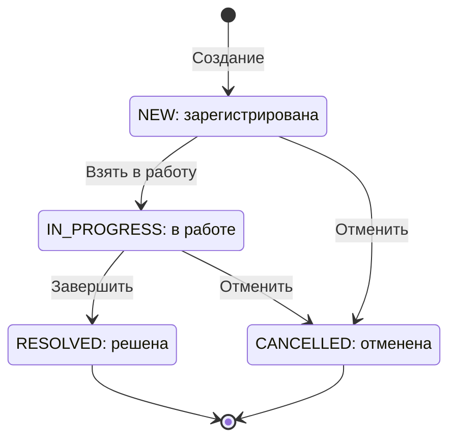
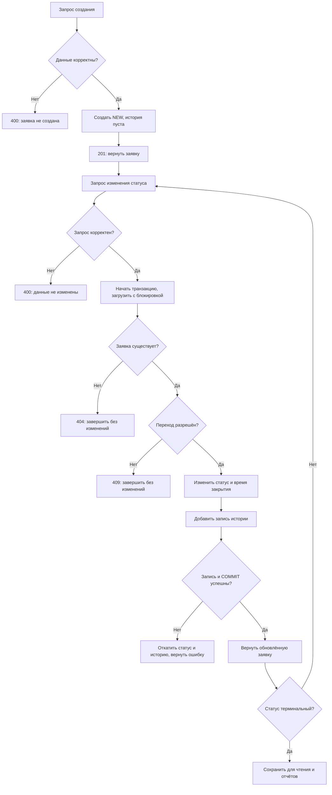

# Процесс обработки заявки

**Автор:** Васильев Юрий, 4П1.23

Документ уточняет BR-01-BR-10 и истории US-02, US-04-US-09. Переходы, редактирование и HTTP-история реализованы; результаты приведены в [описании BL-10](ticket-status-history.md). Поиск и отчёт остаются проектными. Связанные документы: [архитектура](architecture.md), [модель данных](data-model.md), [критерии приёмки](user-stories.md).

## 1. Состояния

| Состояние | Значение | Редактирование описания, приоритета и срока | Время закрытия |
|---|---|---|---|
| `NEW` | Заявка зарегистрирована | Разрешено | `null` |
| `IN_PROGRESS` | Заявка в работе | Разрешено | `null` |
| `RESOLVED` | Обращение решено | Запрещено | Момент завершения |
| `CANCELLED` | Обращение отменено | Запрещено | Момент отмены |

В терминах задания закрытая заявка соответствует `RESOLVED`; дополнительный статус `CLOSED` не вводится. Оба состояния `RESOLVED` и `CANCELLED` являются терминальными, но только `RESOLVED` участвует в среднем времени решения.

Стрелки к конечному узлу означают завершение жизненного цикла, а не удаление из базы. Заявка и история сохраняются и доступны для чтения.

## 2. Матрица переходов

| Из / в | `NEW` | `IN_PROGRESS` | `RESOLVED` | `CANCELLED` |
|---|---|---|---|---|
| `NEW` | `409` | Разрешён | `409` | Разрешён |
| `IN_PROGRESS` | `409` | `409` | Разрешён | Разрешён |
| `RESOLVED` | `409` | `409` | `409` | `409` |
| `CANCELLED` | `409` | `409` | `409` | `409` |

Матрица содержит все 16 сочетаний четырёх состояний: 4 разрешённых и 12 запрещённых. Повторная установка уже имеющегося статуса возвращает `409` и не создаёт запись истории. Нераспознанное имя статуса - ошибка формата `400`, отсутствующая заявка при корректном запросе - `404`.

## 3. Диаграмма процесса

Диаграмма показывает основной сценарий регистрации и изменения статуса. Создание также выполняется в транзакции: при ошибке сохранения `201` не возвращается и новая заявка не остаётся в базе. Для любой ошибки записи применяется общий обработчик ошибок; подробности SQL не выдаются клиенту.

## 4. Сохранение перехода

1. Проверить форму запроса и допустимость имени целевого статуса.
2. В транзакции получить заявку с блокировкой строки; если записи нет, вернуть `404`.
3. Проверить пару текущего и целевого статусов по матрице; при запрете завершить операцию с `409`.
4. Один раз получить время операции через `Clock` после получения блокировки.
5. Изменить статус; при переходе в `RESOLVED` или `CANCELLED` записать это время в `closedAt`, при переходе в `IN_PROGRESS` оставить `null`.
6. Добавить историю с прежним и новым состоянием и тем же временем.
7. Завершить транзакцию. Только после успешного сохранения вернуть успешный ответ.

Если запись истории или фиксация транзакции завершается ошибкой, изменения обеих таблиц откатываются. Отсутствие записи истории не компенсируется отдельной повторной операцией после сохранения статуса.

## 5. Редактирование и чтение

Редактирование также загружает заявку с блокировкой и проверяет её состояние. Разрешены только описание, приоритет и срок у `NEW` и `IN_PROGRESS`. Операция не создаёт историю статусов и не меняет время создания. У `RESOLVED` и `CANCELLED` возвращается `409` без изменения любых полей.

Чтение заявки, списка и истории не меняет данные. История доступна по маршруту `GET /api/tickets/{id}/history`, описанному в [контракте API](api-contract.md). У новой заявки возвращается пустая история, для отсутствующей заявки - `404`.

## 6. Границы времени

| Условие на контрольный момент | Просрочена? |
|---|---|
| `NEW` или `IN_PROGRESS`, `dueAt < now` | Да |
| `NEW` или `IN_PROGRESS`, `dueAt == now` | Нет |
| `NEW` или `IN_PROGRESS`, `dueAt > now` | Нет |
| `NEW` или `IN_PROGRESS`, срок отсутствует | Нет |
| `RESOLVED` или `CANCELLED`, любой срок | Нет |

Статус не меняется автоматически при наступлении срока. Планировщик для записи признака просрочки не требуется: признак вычисляется на момент чтения. Для отчёта используется одна контрольная временная метка на весь расчёт.

Пример границ отчёта: для `[2026-11-01T00:00:00Z, 2026-11-02T00:00:00Z)` заявка, созданная точно в начале, включается, а созданная точно в конце - исключается. Решённая заявка, созданная внутри периода и закрытая 3 ноября, учитывается в среднем, если к моменту чтения имеет статус `RESOLVED`. Данные в примере иллюстративные.

Системные часы должны быть согласованы. Ограничение `closedAt >= createdAt` защищает от отрицательного времени решения: если часы при закрытии показывают время раньше создания, операция завершается ошибкой и откатывается, а не сохраняет отрицательную длительность. Автоматическое исправление временных меток не выполняется.

## 7. Основания и решения

| Решение | Основание |
|---|---|
| Четыре перехода, терминальность, атомарная история | Обязательные BR-04-BR-07 и BR-10 |
| Статус отмены называется `CANCELLED` | Уточнение имени, не заданного в ТЗ |
| При отмене заполняется `closedAt` | Фиксация завершения жизненного цикла; среднее ограничено `RESOLVED` по KR-03 |
| Создание не добавляет историю перехода | История фиксирует изменение существующего состояния; первоначальный статус известен как `NEW` |
| Повтор текущего статуса отклоняется с `409` | Самопереход отсутствует в разрешённой последовательности |
| Срок необязателен, без срока просрочки нет | Дополнительное проектное решение; обязательными в ТЗ названы заголовок и категория |
| Блокировка строки перед изменением | Сохранение бизнес-правил при одновременных запросах |

Эти решения отражены в [контракте API](api-contract.md) и [тест-плане](test-plan.md). Фактические результаты проверок приведены отдельно в [описании BL-10](ticket-status-history.md).
